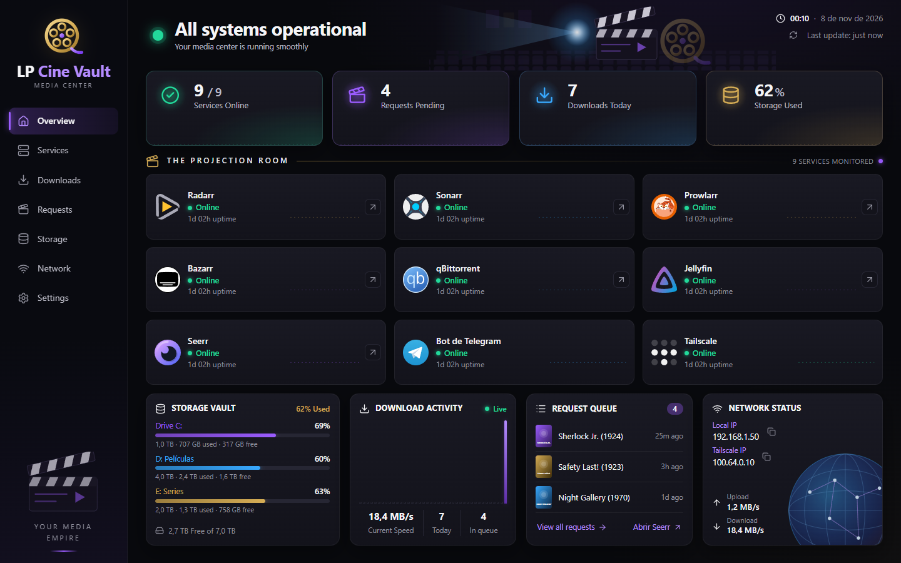
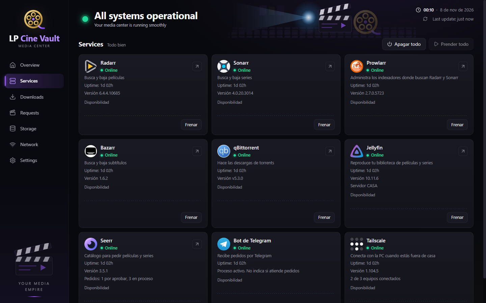
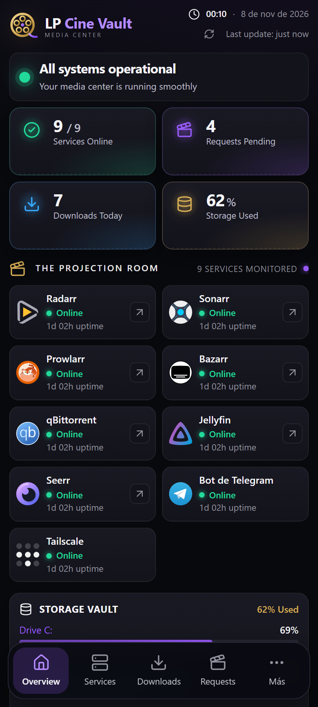
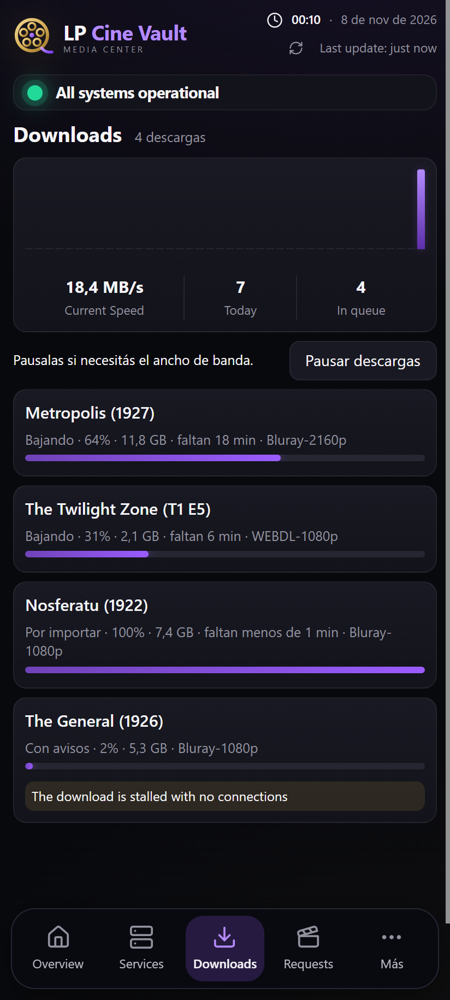
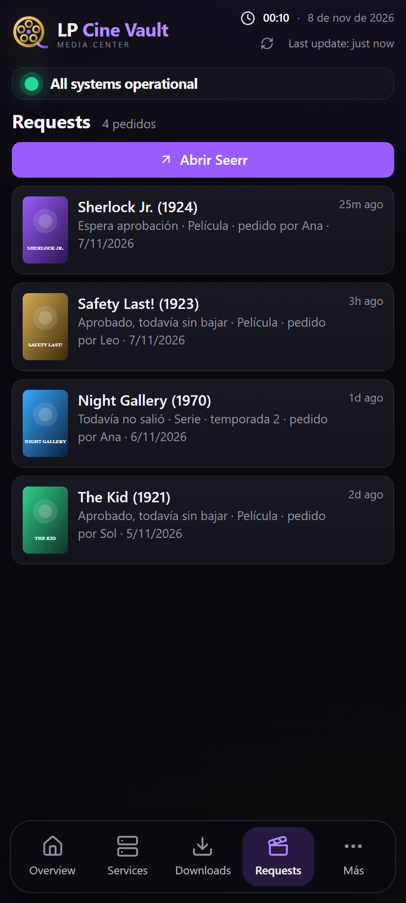

<div align="center">

# 🎬 LP Cine Vault

**El panel de control de tu servidor casero de películas y series.**
Mirá de un vistazo si todo funciona, qué se está bajando y qué pidió cada uno. Prendé o frená cada programa desde la PC o desde el celular.

[](https://github.com/mmunozpatino/lp-media-center/releases/latest)
[](https://github.com/mmunozpatino/lp-media-center/actions/workflows/version.yml)


### Descargar la última versión

[**🪟 Windows (instalador)**](https://github.com/mmunozpatino/lp-media-center/releases/latest/download/LP-Cine-Vault-Setup.exe) &nbsp;·&nbsp;
[**🤖 Android (APK)**](https://github.com/mmunozpatino/lp-media-center/releases/latest/download/LP-Cine-Vault.apk) &nbsp;·&nbsp;
[Todas las versiones y sus novedades](https://github.com/mmunozpatino/lp-media-center/releases)



</div>

> Las capturas usan datos de ejemplo.

## Qué es

Un servidor casero de películas y series suele juntar varios programas. Radarr y Sonarr buscan, qBittorrent baja, Jellyfin
reproduce, Seerr recibe pedidos, y cada uno tiene su propia web, su propio puerto y su propio login. Para saber si algo se
trabó hay que abrir cinco pestañas.

**LP Cine Vault los reúne en una sola pantalla**, con diseño de sala de cine, en una app para Windows y otra para Android:

- 🟢 **Estado de cada servicio:** Radarr, Sonarr, Prowlarr, Bazarr, qBittorrent, Jellyfin, Seerr, el bot de Telegram y Tailscale, con versión, uptime y avisos.
- ⬇️ **Descargas en curso:** progreso, tiempo restante, calidad y descargas trabadas. Un botón pausa y reanuda todo en qBittorrent.
- 🎟️ **Pedidos pendientes:** de Seerr y también de los agregados directo en Radarr o Sonarr, con póster y estado.
- 💾 **Discos:** espacio usado y libre de cada uno, con aviso cuando queda poco.
- 🌐 **Red:** IP local, IP de Tailscale y velocidad de bajada y subida.
- ⏯️ **Prender y frenar** cada programa, o todos juntos. Frenar pide confirmación, y la app comprueba que de verdad quedó hecho.
- 🔗 **Acceso directo** a la web de cada programa y a Seerr.
- 🔄 **Se actualiza sola:** avisa cuando hay una versión nueva y muestra qué cambió. En Windows, con "Actualizar ahora" la baja, comprueba que sea la publicada y se reinstala sola; en Android la baja, la comprueba y Android pide confirmar con un toque.

<div align="center">

</div>

## En el celular

La misma interfaz, pensada para el dedo: una barra flotante abajo y la información justa.

<div align="center">
<table>
  <tr>
    <td></td>
    <td></td>
    <td></td>
  </tr>
  <tr>
    <td align="center">Inicio</td>
    <td align="center">Descargas</td>
    <td align="center">Pedidos</td>
  </tr>
</table>
</div>

- **En casa** se conecta a la PC por el Wi-Fi. **Afuera**, por [Tailscale](https://tailscale.com), sin abrir puertos en el router.
- **Encuentra la PC sola** aunque su IP cambie: prueba la última que funcionó, la de Tailscale y, si hace falta, busca en la red.
- **Se empareja una vez** escaneando un QR que muestra la app de Windows. Cada celular tiene su nombre y se puede quitar desde la PC.

## Seguridad

Pensada para no exponer nada a internet:

- **Sin acceso desde internet:** el backend solo atiende a la propia PC, a la red local y a Tailscale. Rechaza cualquier otra dirección y frena el DNS rebinding.
- **Usuario y contraseña** para entrar desde otro equipo, con sesiones de 30 días y freno tras varios intentos fallidos.
- **Emparejamiento con desafío:** antes de mandar la contraseña, el celular comprueba con un secreto compartido que habla con *su* PC. En otro Wi-Fi, la misma IP puede ser de otra persona.
- **Las claves no salen de la PC:** el backend lee las claves de cada programa localmente y nunca las envía a la app.
- **Sin dependencias en ejecución:** el backend usa solo módulos nativos de Node. La interfaz es un único archivo, sin frameworks ni librerías de terceros.

## Cómo funciona

```text
En casa:  App ──HTTP por la LAN──────────▶ PC:8787 ──▶ backend ──▶ Radarr, Sonarr, qBittorrent, Jellyfin…
Afuera:   App ──HTTP dentro de Tailscale─▶ PC:8787 ──▶ backend ──▶ (todo por 127.0.0.1)
```

| Parte | Qué es |
|---|---|
| `backend/server.js` | Un solo script de Node que consulta cada programa por `127.0.0.1` y expone `/api/status` |
| `ui/index.html` | Toda la interfaz, la misma en Windows y Android |
| `electron/` | App de Windows: instalador NSIS por usuario, lanza el backend e inicia con Windows |
| `android/` | App de Android con Capacitor, con lector de QR de Google Play Services |
| `.github/workflows/version.yml` | En cada cambio corre los tests, compila las dos apps y publica una versión |

## Instalación

> **Ojo:** hoy la app está hecha a medida de un servidor concreto, con las rutas de configuración de cada programa en
> Windows. Sirve como base o inspiración para un servidor parecido. En otro equipo hay que ajustar `backend/server.js`.

1. **En la PC con los programas**, instalá [la app de Windows](https://github.com/mmunozpatino/lp-media-center/releases/latest/download/LP-Cine-Vault-Setup.exe). Lanza su backend y queda iniciando con Windows.
2. **Para que el celular llegue a la PC**, corré `scripts/firewall.ps1` como administrador. Abre el puerto 8787 solo para la red local y Tailscale, en perfil Privado.
3. **Para usarla desde el celular**, en la app de Windows andá a *Settings*, elegí una contraseña y tocá *Emparejar un celular*.
4. **En el celular**, instalá [el APK](https://github.com/mmunozpatino/lp-media-center/releases/latest/download/LP-Cine-Vault.apk). Hay que permitir instalar apps de origen desconocido. Después escaneá el QR.
5. **Para usarla fuera de casa**, sumá el celular y la PC a la misma cuenta de Tailscale.

## Desarrollo

Requiere Node 22 o más nuevo.

```bash
npm install
```

| Comando | Qué hace |
|---|---|
| `npm start` | Abre el backend y la app juntos |
| `npm test` | Tests del backend y la interfaz, con programas simulados |
| `npm run dist` | Genera el instalador de Windows en `dist/` |
| `npm run apk` | Genera el APK de Android (necesita Android Studio) |

Cada push a `main` publica una versión nueva. Las novedades que ve la app salen de los mensajes de commit, así que se
escriben en español y pensando en quien la usa.
